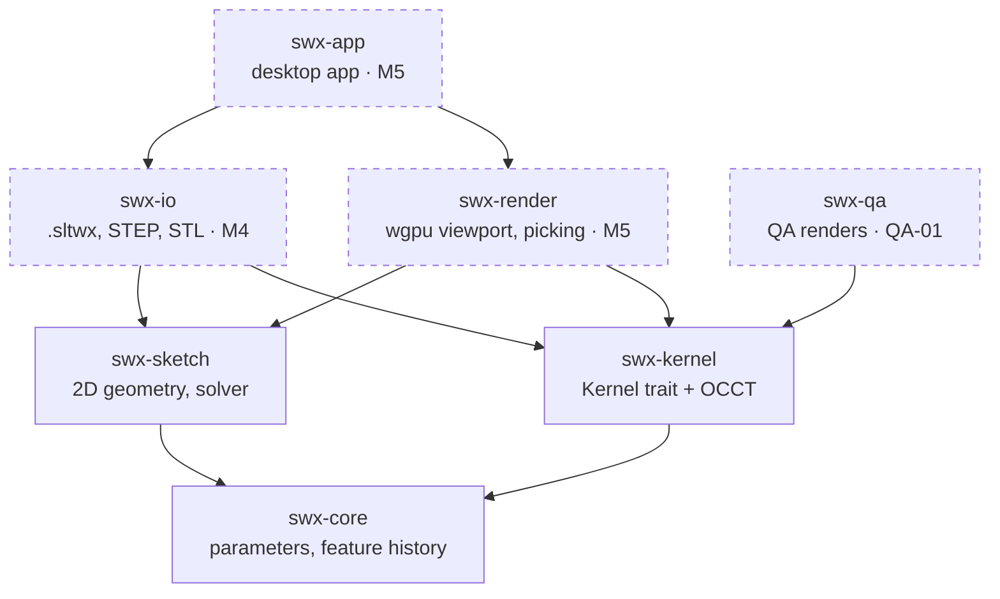
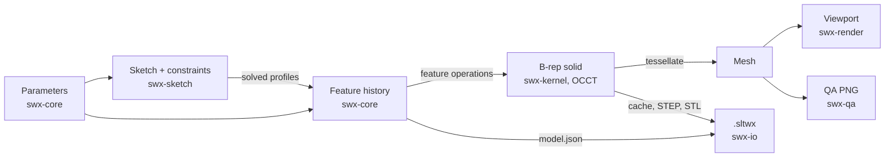

# System map

How Saulitwerx fits together. GitHub renders the diagrams. Milestone status lives in `docs/ROADMAP.md`; decisions live in `docs/ARCHITECTURE.md`.

Update this file when a crate is added or the data flow changes. The weekly report flags it when the crate list here differs from `crates/`.

## Crates and dependency direction

An arrow means "may depend on", per the layering in `ARCHITECTURE.md`: app, then render and io, then kernel and sketch, then core. `swx-core` and `swx-sketch` never depend on the kernel. Solid boxes exist on `main`; dashed boxes are planned. Today no workspace crate depends on another.

## Data flow

